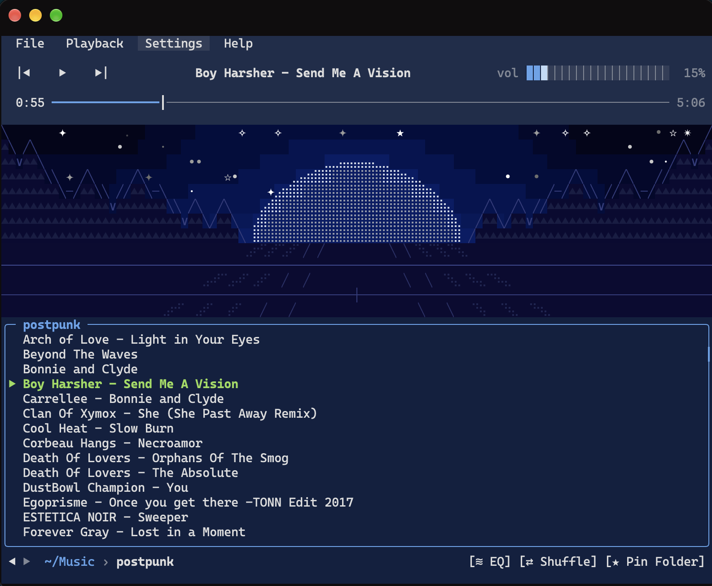
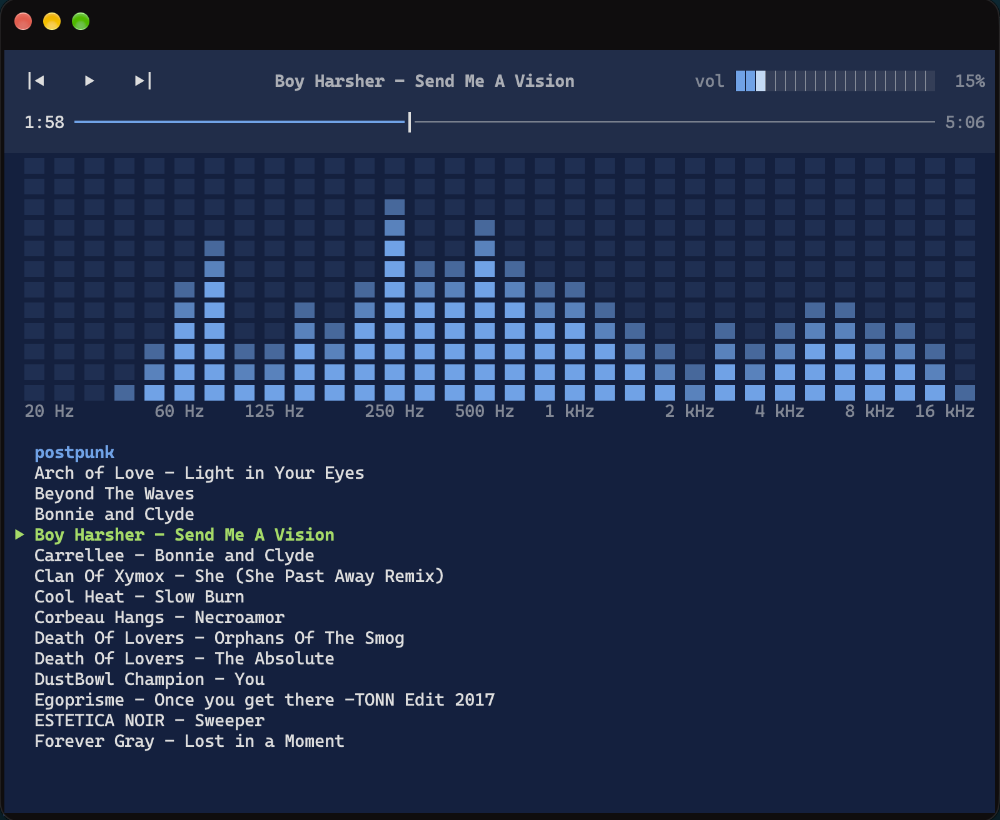

# Urchin Music Player

<p align="center">
  
</p>

A cross-platform, folder-first music player for the terminal, built in Rust.
Everything works with the mouse or the keyboard alone.

Made for music that already lives in an organized folder tree, with tag support
when you want it.

<table>
  <tr>
    <td align="center" width="50%"></td>
    <td align="center" width="50%"></td>
  </tr>
  <tr>
    <td align="center">Standard View</td>
    <td align="center">Minimalist View</td>
  </tr>
</table>

## Key features

- **Per-song EQ:** adjust a song and Urchin remembers it, no save step
- **Per-folder EQ:** pick a preset and the whole folder follows; it never overrides a song's own EQ
- **Your own presets:** save any EQ curve as a named preset
- **EQ follows your music:** rename or move songs and folders and they keep their EQ
- **Search:** any words, any order, capitals and accents ignored
- **Themes:** all 900+ iTerm2-Color-Schemes, with live preview
- **Visualizers:** spectrum analyzer, scopes and more
- **Minimalist View:** no frames, no menu bar until you want it

Urchin also has what you'd expect from a modern music player: gapless playback,
crossfade, ReplayGain, a queue that picks up where you left off, playlists,
shuffle by album and a tag-based Library view.

**[Read the User Guide](USER_GUIDE.md)** for everything Urchin can do.

## Install

Needs [Rust](https://rustup.rs) 1.89 or newer. Urchin is on
[crates.io](https://crates.io/crates/urchin-player) as `urchin-player`, and the
command it installs is `urchin`:

```sh
cargo install urchin-player --locked
urchin            # opens your music folder
urchin ~/Music    # or any folder
```

To update, run the same `cargo install` again. To build from a clone of this
repo instead, use `cargo install --path . --locked` in its folder.

That plain build plays MP3, FLAC, Ogg Vorbis, AAC/M4A, WAV, AIFF and MKV, and
needs nothing but Rust on macOS and Windows. Linux and the BSDs also need the
ALSA development files and pkg-config (below).

Three more kinds of files are optional Cargo features. Each needs a native library:

| Feature | Adds | Library |
|---|---|---|
| `ffmpeg` | Opus, WMA, APE, WavPack, Musepack, DSD, TTA, AC3 | FFmpeg |
| `tracker` | mod, xm, it, s3m and other tracker modules | libopenmpt |
| `chiptune` | nsf, spc, vgm, gbs and other game music | Game Music Emu |
| `full` | all three | all three |

```sh
cargo install urchin-player --locked --features full
cargo install urchin-player --locked --features "tracker chiptune"   # pick some
```

### macOS

Nothing extra for the plain build. For `full`:

```sh
brew install pkg-config ffmpeg libopenmpt game-music-emu
```

### Debian, Ubuntu, Raspberry Pi OS

```sh
sudo apt install pkg-config libasound2-dev
# only for --features full:
sudo apt install libclang-dev libavcodec-dev libavformat-dev libavutil-dev \
  libswresample-dev libopenmpt-dev libgme-dev
```

### Arch Linux and Omarchy

```sh
sudo pacman -S --needed rust pkgconf alsa-lib pipewire-alsa
# only for --features full:
sudo pacman -S --needed clang ffmpeg libopenmpt libgme
```

`pipewire-alsa` sends Urchin's sound through PipeWire. Installs that picked
PipeWire for audio (Omarchy does) already have it.

### FreeBSD and NetBSD

Audio uses ALSA through the alsa-lib package. Not tested yet; package names
are from the FreeBSD ports and NetBSD pkgsrc listings and may differ.

```sh
pkg install rust pkgconf alsa-lib                 # FreeBSD
pkgin install rust pkgconf alsa-lib               # NetBSD
# only for --features full, FreeBSD:
pkg install ffmpeg libopenmpt libgme
# only for --features full, NetBSD:
pkgin install ffmpeg libopenmpt game-music-emu
```

### Windows

1. Install Rust with [rustup-init.exe](https://rustup.rs). It will ask you to
   install the Visual Studio C++ Build Tools; accept ("Desktop development
   with C++").
2. In PowerShell: `cargo install urchin-player --locked`
3. Run `urchin` in Windows Terminal (not the old console window).

Audio goes through WASAPI. Windows builds are untested so far, there are no
media keys on Windows, and the `ffmpeg`, `tracker` and `chiptune` features
are not set up for Windows (they need FFmpeg, libopenmpt and Game Music Emu
found through pkg-config).

### OpenBSD

Not supported yet: the audio library Urchin uses (cpal) has no OpenBSD
backend, so it needs a sndio backend first.

## Terminals

Urchin works best in a modern terminal. 

- [Alacritty](https://alacritty.org) (Rust)
- [Ghostty](https://ghostty.org) (Zig)
- [iTerm2](https://iterm2.com) (Objective-C)
- [kitty](https://sw.kovidgoyal.net/kitty/) (C, Python, Go)
- [Rio](https://rioterm.com) (Rust)
- [WezTerm](https://wezterm.org) (Rust)

In beta:

- [MetalTerm](https://metalterm.dev) (Rust)
- [OmniPTY](https://omnipty.com) (Rust)

## Built with

- [ratatui](https://ratatui.rs) and [crossterm](https://github.com/crossterm-rs/crossterm): interface and mouse
- [Symphonia](https://github.com/pdeljanov/Symphonia): decoding
- [rubato](https://github.com/HEnquist/rubato): resampling
- [cpal](https://github.com/RustAudio/cpal): audio output (CoreAudio, WASAPI, ALSA)
- [souvlaki](https://github.com/Sinono3/souvlaki): media keys and Now Playing (macOS, MPRIS on Linux)
- [zbus](https://github.com/dbus2/zbus): D-Bus (Show in File Manager on Linux)
- [scope-tui](https://github.com/alemidev/scope-tui): Oscilloscope, Spectroscope, Vectorscope
- [iTerm2-Color-Schemes](https://iterm2colorschemes.com): themes
- [dirs](https://github.com/dirs-dev/dirs-rs): config and data folders
- [signal-hook](https://github.com/vorner/signal-hook): clean shutdown on signals

### Optional (Cargo features)

- [FFmpeg](https://ffmpeg.org): extra formats, WebM/Opus
- [libopenmpt](https://lib.openmpt.org): tracker modules
- [Game Music Emu](https://github.com/libgme/game-music-emu): chiptune

## Security

Music files come from anywhere, so Urchin treats every file as hostile:

- The plain build decodes with Symphonia, which is pure Rust.
- Only regular files are opened. A pipe, socket or device named like a song
  (or a link to one) is ignored.
- If Symphonia (or Urchin's own code) trips over a malformed file, that song
  ends and Urchin keeps playing.
- FFmpeg only gets a file whose extension it should handle, only with the
  matching demuxer (a "song.mp3" can't turn out to be a playlist or a stream),
  and can only open local files.
- Playlists can't point at other machines (`file://server/…`, and
  `\\server\share` on Windows, where just checking such a path sends your
  Windows login hash to that server). To play from a network share, mount it
  or map it to a drive letter.

The optional features hand files to C and C++ libraries, so keep those
libraries updated through your package manager. Game Music Emu (`chiptune`) is
the riskiest: its console emulators have had exploitable bugs, and the build
refuses versions older than 0.6.3. If you don't play game music, leave it off.

## License

MIT. See [LICENSE](LICENSE).
